# E-Chetak's

Aplikasi web **pemesanan jasa sablon & percetakan custom** (jaket, topi, mug, dll.) dengan alur lengkap dari pelanggan sampai admin: pilih produk → upload desain → invoice → upload bukti bayar → konfirmasi oleh admin.

> Proyek kuliah *Proyek Perangkat Lunak* (2020) — PHP native + MySQL, tanpa framework.

<p align="center">
  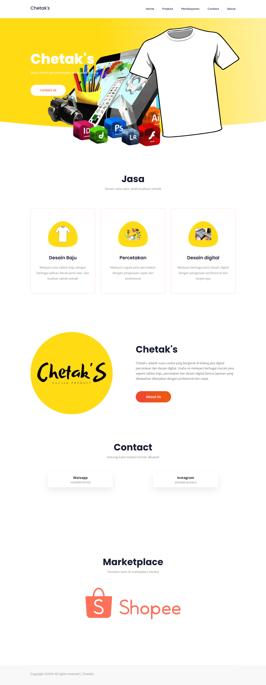
</p>

## Daftar isi

- [Fitur](#fitur)
- [Screenshot](#screenshot)
- [Teknologi](#teknologi)
- [Menjalankan di lokal](#menjalankan-di-lokal)
- [Akun admin](#akun-admin)
- [Alur & status pesanan](#alur--status-pesanan)
- [Struktur database](#struktur-database)
- [Struktur folder](#struktur-folder)
- [Deploy ke server](#deploy-ke-server)
- [Catatan & batasan](#catatan--batasan)
- [Tim](#tim)

## Fitur

**Pelanggan (publik)**
- Katalog produk dengan harga, dibaca langsung dari database
- Form pemesanan: nama, alamat, no. HP, jumlah, jasa kirim (J&T / JNE / TIKI / Sicepat), **upload file desain**, catatan
- Total otomatis = `harga × jumlah + ongkir`, lalu **invoice** dengan nomor order acak 8 digit
- Form pembayaran: kirim **bukti transfer** berdasarkan nomor order
- Halaman About & Contact

**Admin** (`/admin`)
- Login dengan username, password, dan **captcha gambar**
- Dashboard ringkasan jumlah pesanan per status
- CRUD produk (tambah / edit / hapus, upload gambar)
- Daftar pesanan: selesaikan atau batalkan pesanan
- Daftar pembayaran: lihat bukti transfer, **terima / tolak** pembayaran

## Screenshot

### Sisi pelanggan

| Katalog produk | Form pemesanan |
|---|---|
| 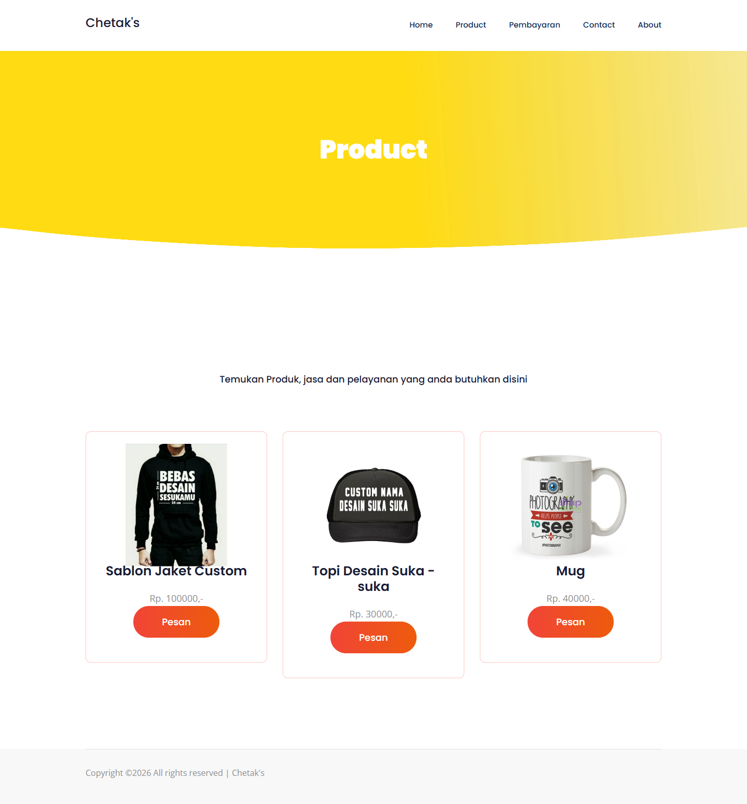 | 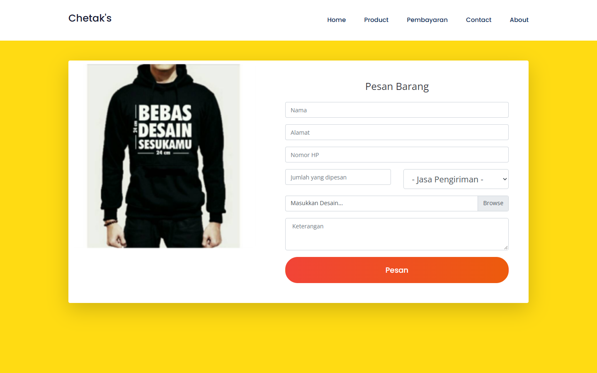 |
| **Invoice** | **Form pembayaran** |
| 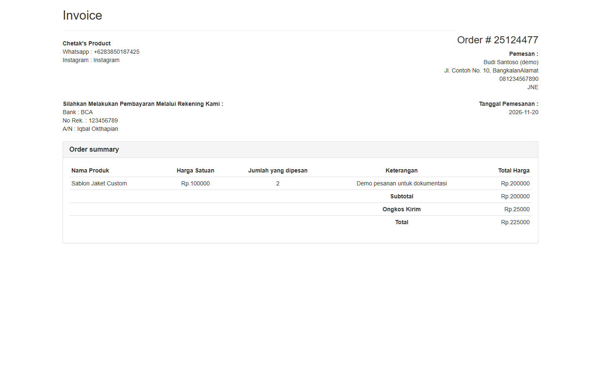 | 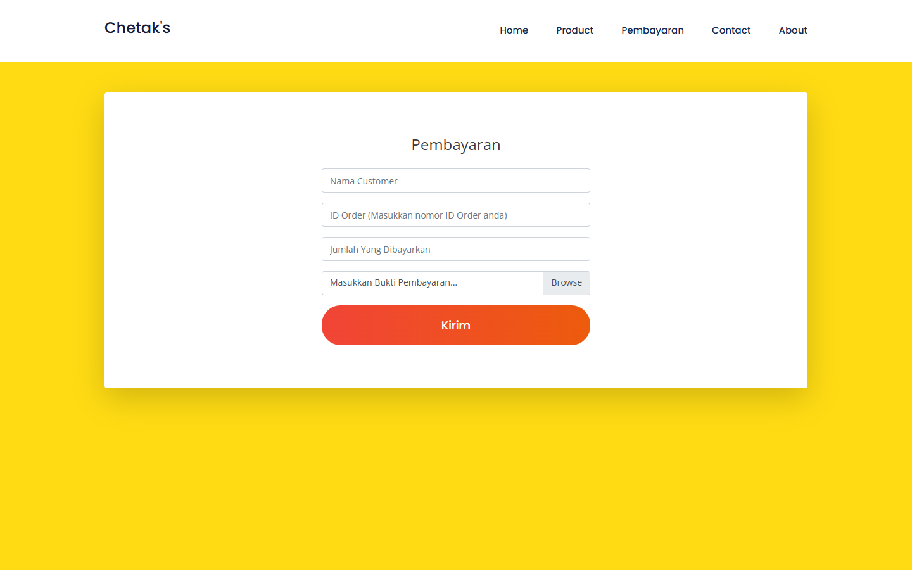 |

<details>
<summary>Halaman About & Contact</summary>

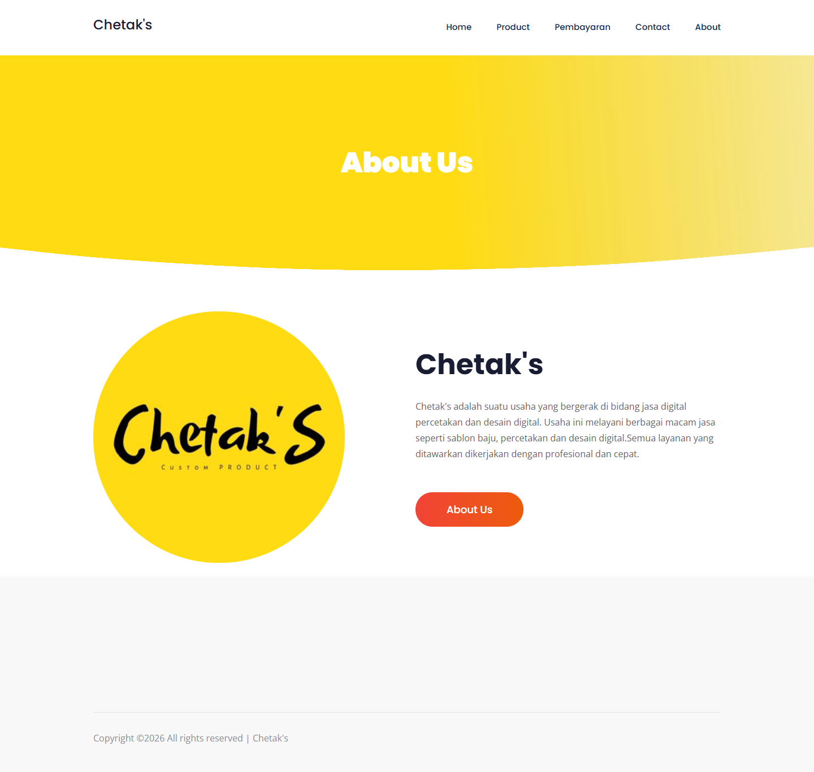
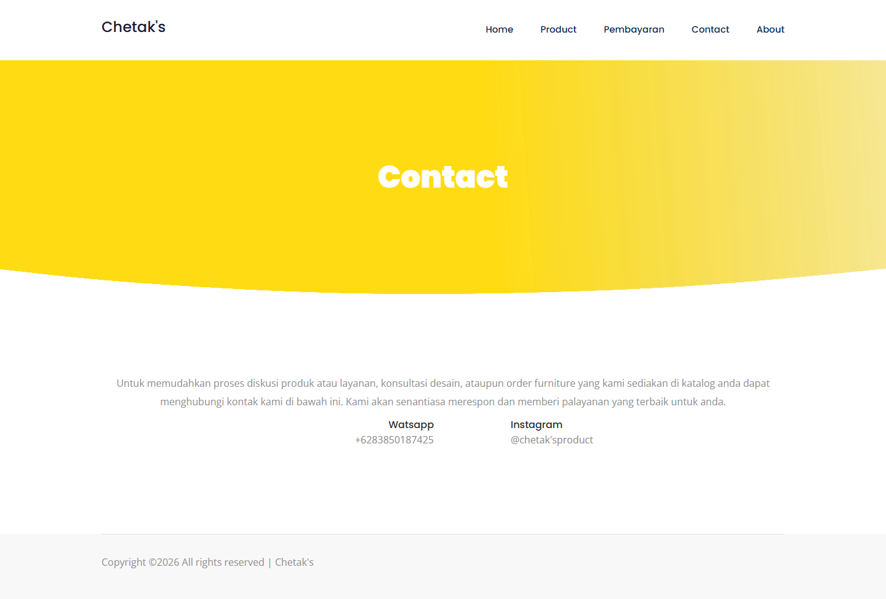

</details>

### Sisi admin

| Login (dengan captcha) | Dashboard |
|---|---|
| 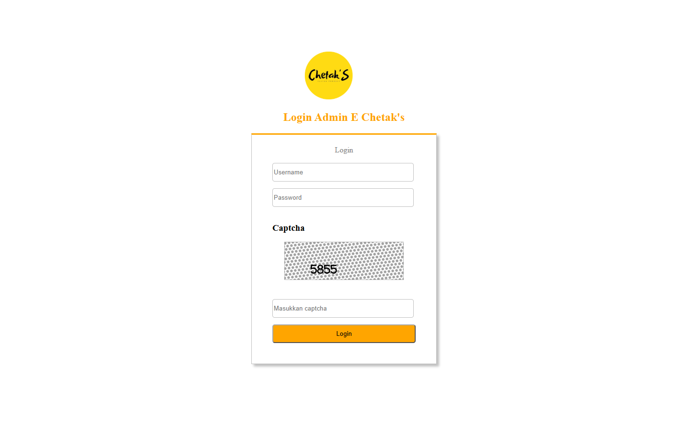 | 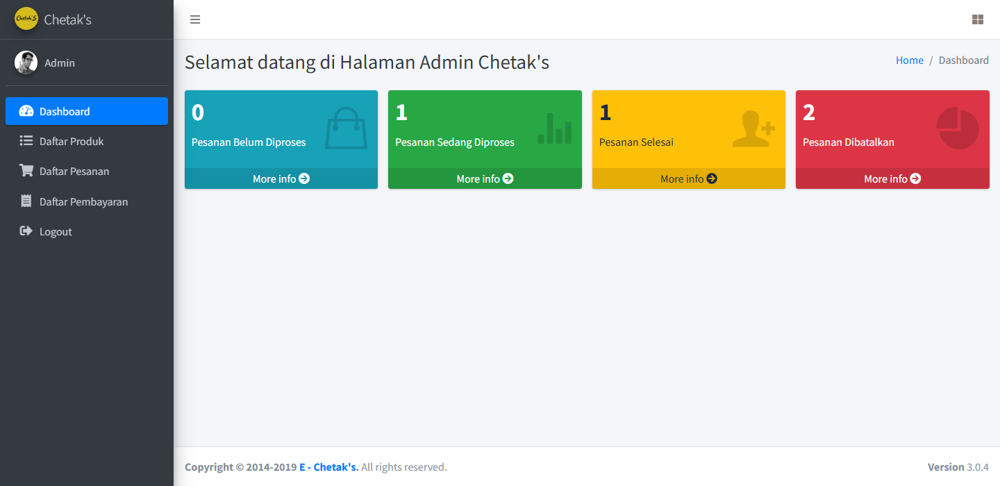 |

**Daftar produk**
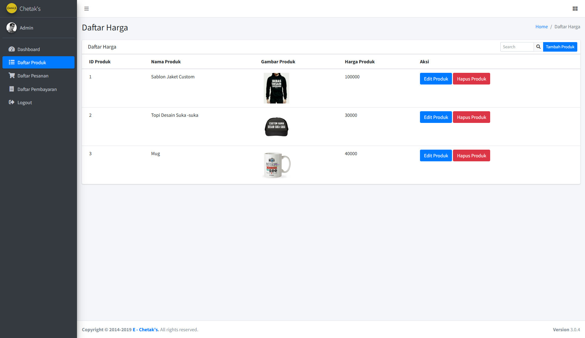

**Daftar pesanan**
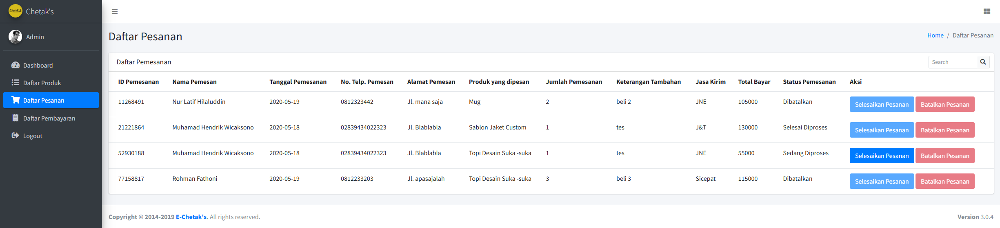

**Daftar pembayaran** (terima / tolak bukti transfer)
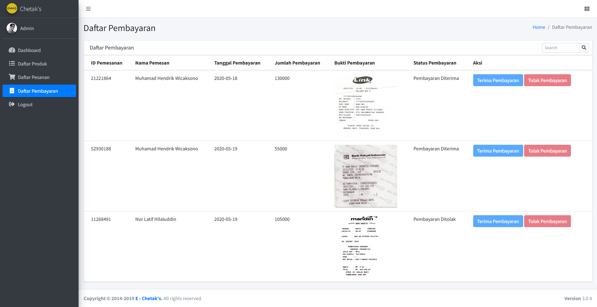

<details>
<summary>Form tambah produk</summary>

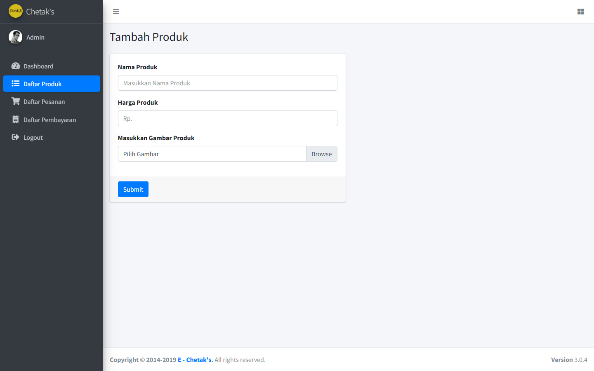

</details>

## Teknologi

| Lapisan | Yang dipakai |
|---|---|
| Backend | PHP native (PDO + prepared statement untuk insert/update), session untuk login admin |
| Database | MySQL 8 / MariaDB (skema di [`chetaks.sql`](chetaks.sql)) |
| Frontend publik | Bootstrap 4.4, SB Admin 2 (form), Owl Carousel, SlickNav, Font Awesome, Themify Icons, font Poppins |
| Frontend admin | [AdminLTE 3](https://adminlte.io/) |
| Captcha | GD + FreeType (`admin/captcha.php`) |

Diuji jalan di **PHP 8.3 dan 8.4**.

## Menjalankan di lokal

Pilih salah satu. Semuanya butuh database `chetaks` yang di-import dari [`chetaks.sql`](chetaks.sql).

### Opsi A — Laragon / XAMPP (paling mirip aslinya)

1. Letakkan folder project di `C:\laragon\www\echetaks` (Laragon) atau `C:\xampp\htdocs\echetaks` (XAMPP).
2. Start Apache + MySQL.
3. Buat database dan import:
   ```bash
   mysql -u root -e "CREATE DATABASE chetaks CHARACTER SET utf8mb4"
   mysql -u root chetaks < chetaks.sql
   ```
4. Buka `http://localhost/echetaks/` (atau `http://echetaks.test` di Laragon).

Koneksi default: host `localhost`, user `root`, password kosong — sesuai [`koneksi.php`](koneksi.php).

### Opsi B — PHP built-in server (tanpa Apache)

Butuh PHP 8.x dengan ekstensi `pdo_mysql` dan `gd`, plus MySQL yang sudah jalan dan database sudah di-import (langkah 3 di atas).

```bash
php -S 127.0.0.1:8765 -t .
```

Buka `http://127.0.0.1:8765/`. Admin di `http://127.0.0.1:8765/admin/login.php`.

### Opsi C — Docker Compose

```bash
cp .env.example .env        # lalu isi password di .env
docker compose up -d --build
```

Buka `http://127.0.0.1:8080/`. Database dan sample data dibuat otomatis saat pertama kali jalan. Detail lengkap ada di [DEPLOY.md](DEPLOY.md).

### Konfigurasi database

[`koneksi.php`](koneksi.php) membaca environment variable, dengan default setting lokal:

| Variable | Default |
|---|---|
| `DB_HOST` | `localhost` |
| `DB_PORT` | `3306` |
| `DB_NAME` | `chetaks` |
| `DB_USER` | `root` |
| `DB_PASS` | *(kosong)* |

## Akun admin

| | |
|---|---|
| URL | `/admin/login.php` |
| Username | `admin` |
| Password | `admin123` |
| Captcha | angka 4 digit pada gambar |

> ⚠️ Ini kredensial bawaan dari sample data. **Wajib diganti sebelum dipublikasikan ke internet** — caranya ada di [DEPLOY.md](DEPLOY.md#3-ganti-password-admin-wajib).

## Alur & status pesanan

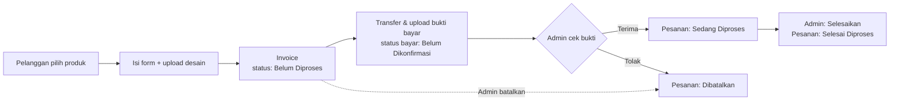

| Status pesanan (`status_pemesanan`) | Status pembayaran (`status_pembayaran`) |
|---|---|
| 1 Belum Diproses | 1 Belum Dikonfirmasi |
| 2 Sedang Diproses | 2 Pembayaran Diterima |
| 3 Selesai Diproses | 3 Pembayaran Ditolak |
| 4 Dibatalkan | |

## Struktur database

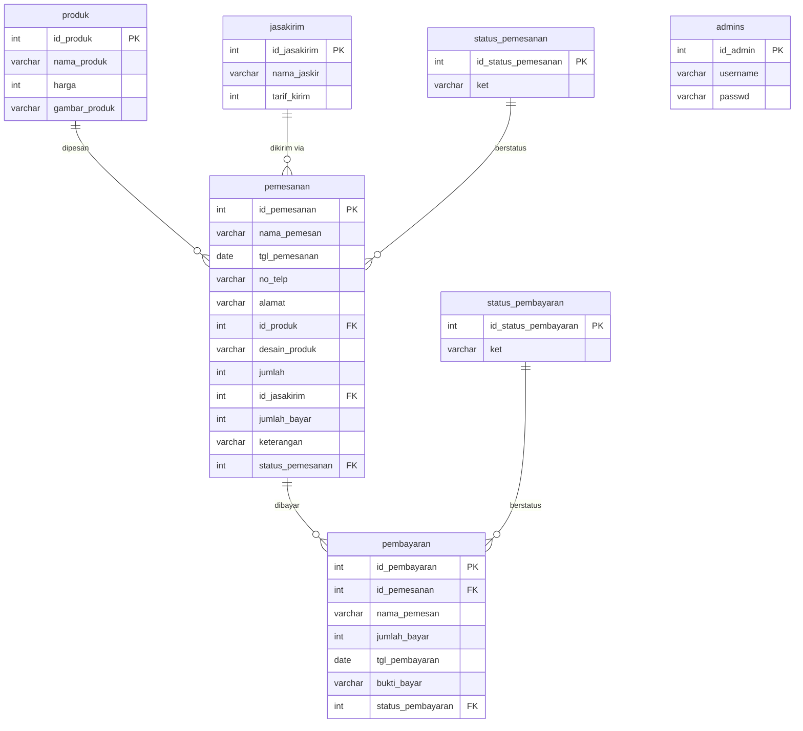

## Struktur folder

```
.
├── index.php, product.php, order.php,   # halaman publik
│   invoice.php, pembayaran.php,
│   about.php, contact.php
├── koneksi.php                          # koneksi PDO (baca env DB_*)
├── function/                            # logika bisnis (function.php), validasi, hapus produk
├── admin/                               # panel admin (AdminLTE) + login & captcha
├── css/ js/ scss/ fonts/ vendor/ img/   # aset frontend publik
├── desain/                              # upload desain dari pelanggan   (writable)
├── buktibayar/                          # upload bukti transfer          (writable)
├── img/product/                         # gambar produk                  (writable)
├── chetaks.sql                          # skema + sample data
├── Dockerfile, docker-compose.yml, docker/   # setup container
├── DEPLOY.md                            # panduan deploy ke VPS
└── docs/screenshots/                    # screenshot untuk README ini
```

## Deploy ke server

Panduan lengkap (Docker Compose, Nginx + PHP-FPM, HTTPS, backup, update, troubleshooting) ada di **[DEPLOY.md](DEPLOY.md)**.

## Catatan & batasan

Proyek ini dibuat sebagai tugas kuliah, jadi ada beberapa hal yang sebaiknya diketahui sebelum dipakai serius:

**Perbaikan yang sudah dilakukan saat menghidupkan ulang proyek (2026)**
- Koneksi DB dibuat bisa dikonfigurasi lewat environment variable (default lokal tidak berubah).
- `INSERT ... VALUES ('')` pada kolom auto-increment diperbaiki — gagal di MySQL 8 (strict mode), sehingga **tambah produk dan kirim pembayaran tidak jalan**.
- Kolom `desain_produk`, `bukti_bayar`, `gambar_produk` dilebarkan ke `varchar(255)`; sebelumnya upload dengan nama file panjang membuat pemesanan gagal di MySQL 8.
- Aksi admin (`pesananbatal`, `pesananselesai`, `terimabayar`, `tolakbayar`, `deleteProduct`) sebelumnya **bisa dipanggil tanpa login**; sekarang diblok kalau belum login.

**Masih ada (belum diperbaiki)**
- Beberapa query menyisipkan input langsung ke string SQL → **rentan SQL injection**: `order.php`, `invoice.php`, `admin/editproduk.php`, `function/deleteProduct.php`, dan fungsi `pemesanan()` di `function/function.php`. Perlu diubah ke prepared statement dengan `bindValue`.
- Tidak ada proteksi CSRF; aksi admin memakai link `GET`.
- Upload hanya divalidasi lewat ekstensi (jpg/png), dan nama file asli dipakai apa adanya (file dengan nama sama akan tertimpa).
- Password admin memakai SHA-256 tanpa salt.
- Nomor rekening, WhatsApp, dan Instagram di halaman invoice/contact masih data contoh.
- Halaman publik memuat font/ikon dari CDN (Google Fonts, dll.) sehingga butuh internet agar tampilan 100% sama.

## Tim

Proyek Perangkat Lunak *E - Chetak's*

| Nama | NIM |
|---|---|
| Nur Latif Hilaluddin | 170411100053 |
| Muhamad Hendrik Wicaksono | 170411100057 |
| Ashof Barkhia Ridwan | 170411100064 |
| Rosyaifa Meifani Pratami | 170411100080 |
| Rohman Fathoni | 170411100089 |
